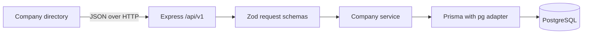

# Architecture and decisions

## Runtime flow

The two repositories own separate runtimes and lockfiles. The Next.js app renders navigation/layout and interactive company forms. Express owns the API contract and persistence. PostgreSQL is never accessible from the browser. The root folder contains local coordination scripts, with no shared runtime package or cross-repository import.

## Why this layout

A modular monolith fits an early project: features live together under `src/modules`, with a small shared infrastructure layer. Independent microservices, generic repositories, event buses, and cross-repo packages would add coordination before a concrete need exists. Grow within the module boundaries first. Next.js uses App Router and feature folders so route files stay small and product behavior can expand independently.

## Data and compatibility

Companies use UUID primary keys, constrained field lengths, a two-state status enum, and created/updated timestamps. Archiving preserves records and supports restore. An index covers status and creation ordering. Migrations are committed SQL; client code is regenerated. Search currently uses case-insensitive contains matching; measure before adding full-text/trigram indexes. Concurrent updates currently use last-write-wins; add version-based concurrency if the product needs collaborative editing.

The API returns explicit JSON envelopes and versioned paths. `docs/openapi.json` is the contract; frontend domain types mirror it. Contract changes require updates to both repositories and lifecycle checks. Introduce a generated client or published contract package when repeated drift makes it worthwhile, not a relative dependency between checkouts.

## Identity is the next boundary

There is no user, membership, role, or tenant model yet. Choosing one without product requirements would encode the wrong access semantics. The development directory is accessible locally without login. Production startup is blocked until this boundary exists. The next slice should introduce the identity provider, organization model and membership policy, tests for denied cross-organization access, and authorization scoped persistence queries. Then build employees, departments, projects, or finance on that foundation.

## Operations

Node.js 24 is the common runtime. Each app has CI and a Docker build starting point. The database has persistent local storage and a separate test database; example credentials are local-only. Production needs managed credentials, TLS, backups with tested restore, migrations as a release step, and readiness-driven rollouts. Limits and logging are useful defaults, not substitutes for identity or production operations.

## Verification boundaries

Boundary tests exercise invalid input, unknown writable fields, unsafe URL schemes, oversized/malformed JSON, CORS and errors. Integration tests exercise actual PostgreSQL persistence and archive/restore. Browser tests exercise the company flow and disconnected API state. Both Docker images have been built successfully locally; production access control remains intentionally incomplete; CI has been authored but does not run remotely until published. Local checks are the evidence for this initial implementation.
